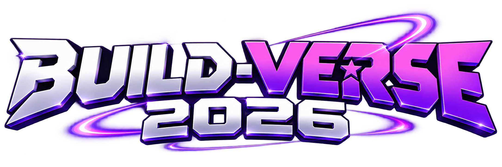
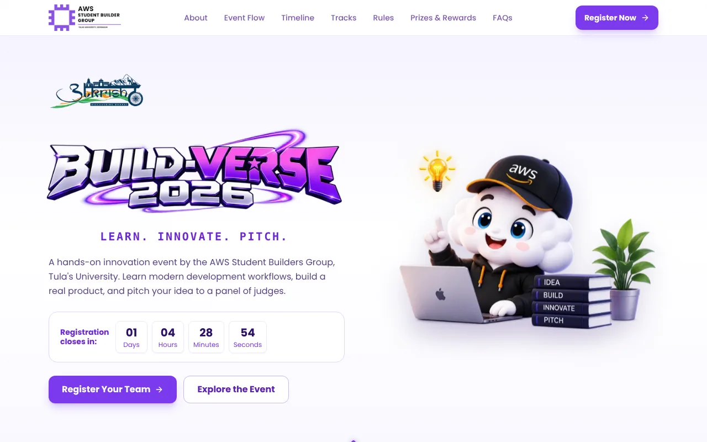
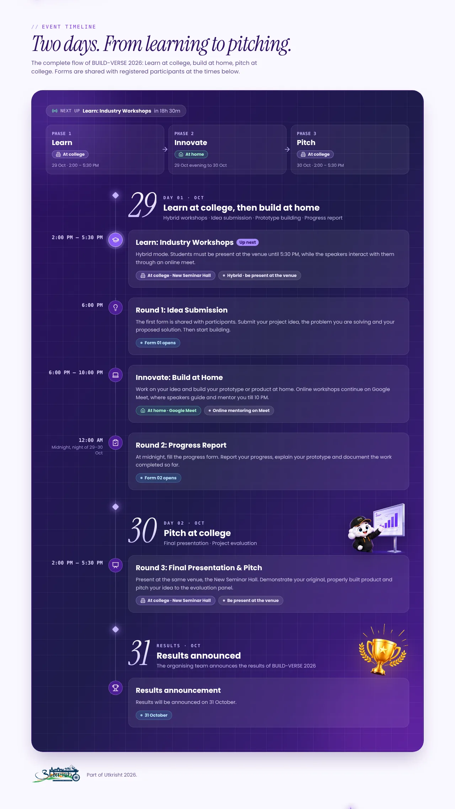
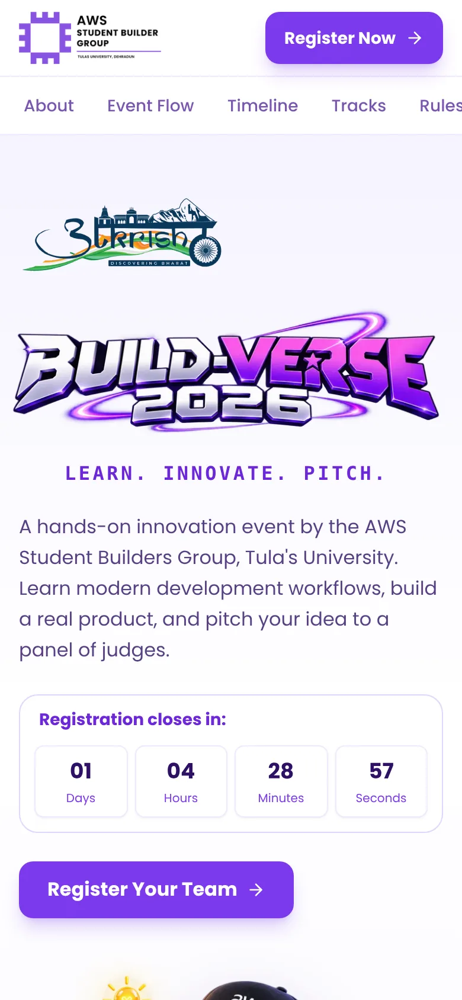
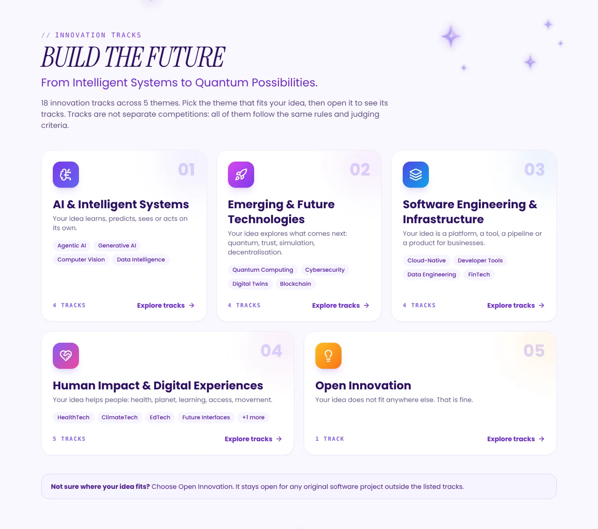

<div align="center">



### Learn. Innovate. Pitch.

The official microsite for **BUILD-VERSE 2026**, a two-day hands-on innovation event
by the **AWS Student Builders Group, Tulas University**.




</div>

---

## Table of contents

- [Event at a glance](#event-at-a-glance)
- [What is on the site](#what-is-on-the-site)
- [Screenshots](#screenshots)
- [Tech stack](#tech-stack)
- [Getting started](#getting-started)
- [Editing event content](#editing-event-content)
- [Project structure](#project-structure)
- [How it works](#how-it-works)
- [Testing](#testing)
- [Deployment](#deployment)
- [Contributing](#contributing)
- [Credits](#credits)

---

## Event at a glance

| | |
| --- | --- |
| **Event** | BUILD-VERSE 2026, part of Utkrisht 2026 |
| **Organiser** | AWS Student Builders Group, Tulas University |
| **Dates** | Day 1 on 29 October 2026, Day 2 on 30 October 2026, results on 31 October 2026 |
| **Format** | Learn at college, Build at home, Pitch at college |
| **Venue** | New Seminar Hall, Tulas University (Phase 1 and Phase 3) |
| **Who can join** | Students of Tulas University |
| **Team size** | 1 to 4 members (solo is allowed) |
| **Fee** | ₹100 per team |
| **Registration closes** | 28 October 2026, 11:59 PM IST |
| **Registration** | Google Form, opened from every "Register" button and from `/register` |

> The values above mirror `config/buildverse.ts`. If the two ever disagree, the config file is right.

---

## What is on the site

| Section | What it does |
| --- | --- |
| **Hero** | Event title, tagline, live registration countdown and call-to-action buttons |
| **About** | What BUILD-VERSE is, with the mascot artwork and three highlights |
| **Event Flow** | The three phases (Learn, Innovate, Pitch), each tagged **At college** or **At home** |
| **Timeline** | Day 1, Day 2 and results day as a "mission route": a three-phase strip, the two forms and live **Up next / Live now / Done** status |
| **Tracks** | 5 themes covering 18 innovation tracks. Each theme opens in an accessible modal |
| **Rules** | Eligibility, team size, fee, originality and tooling rules |
| **Prizes & Rewards** | Prize pool and judges panel |
| **FAQs** | Collapsible answers, including how the hybrid format works |
| **Contact** | Organiser phone numbers and the WhatsApp community link |
| **Closing CTA** | Final call-to-action over the campus scene, with Utkrisht branding |

Highlights:

- **Static home page.** Built once and served from a CDN. Time-dependent UI (countdown, open or closed registration, schedule status) is computed in the visitor's browser.
- **Mobile first.** Checked at phone widths with no sideways scrolling. The track modal becomes a bottom sheet on small screens, and the mobile tab strip scrolls to keep the active section visible.
- **Accessible.** Native `<dialog>` modal with Esc to close and focus return, visible focus states, reduced-motion friendly animations, and axe checks with no violations on the schedule.
- **Smooth motion.** GSAP scroll animations with Lenis smooth scrolling, turned off on touch devices.
- **One config file.** Dates, tracks, rules, FAQs, prizes and links all live in `config/buildverse.ts`.

---

## Screenshots

<table>
  <tr>
    <td width="68%"></td>
    <td width="32%"></td>
  </tr>
  <tr>
    <td colspan="2"></td>
  </tr>
</table>

---

## Tech stack

| Area | Choice |
| --- | --- |
| Framework | [Next.js 16](https://nextjs.org/) (App Router, Turbopack) |
| UI | React 19, TypeScript 5.7 |
| Styling | Tailwind CSS 3.4 |
| Animation | GSAP + `@gsap/react`, [Lenis](https://lenis.darkroom.engineering/) smooth scroll |
| Icons | `lucide-react` |
| Fonts | Poppins (body), JetBrains Mono (technical labels), Instrument Serif Italic (headings, bundled locally) |
| Images | `next/image` with WebP assets |
| Tests | Node's built-in test runner |

There is no backend, database or environment variable. Registration is handled by a Google Form.

---

## Getting started

**Requirements:** Node.js 20 or newer (developed on Node 22) and npm.

```bash
# 1. Clone
git clone https://github.com/piyush-lingwal/BUILDVERSE.git
cd BUILDVERSE

# 2. Install
npm install

# 3. Start the dev server
npm run dev
```

Open <http://localhost:3000>.

### Scripts

| Command | What it does |
| --- | --- |
| `npm run dev` | Start the development server |
| `npm run build` | Create a production build |
| `npm start` | Serve the production build |
| `npm test` | Run the unit tests |

> `next build` downloads Google Fonts (Poppins and JetBrains Mono) at build time, so the first build needs internet access.

---

## Editing event content

Almost everything a visitor reads is edited in **one file**: [`config/buildverse.ts`](config/buildverse.ts). Change a value, redeploy, done.

| To change | Edit this key |
| --- | --- |
| Registration deadline | `registrationDeadline` |
| Registration form link | `registrationFormUrl` (also update the `/register` redirect in `next.config.ts`) |
| Fee, team size, eligibility | `feeInr`, `teamSize`, `eligibility` |
| The three phases (place, time, summary) | `phases` |
| Schedule (days, times, forms, badges) | `days[].steps[]` |
| "Results announced" line | `resultsLine` |
| Innovation tracks and themes | `trackTheme`, `trackCategories` |
| Rules and FAQs | `rules`, `faqs` |
| Prize pool and judges | `prize`, `judges` |
| Contacts and WhatsApp link | `contacts`, `whatsappUrl` |

Schedule rules worth knowing:

- Write dates with the IST offset, for example `"2026-10-29T18:00:00+05:30"`. Without the offset, a visitor in another time zone would see the wrong status.
- A step shows **Live now** and **Done** only when it has both `start` and `end`. A step with only `start` shows **Started** after that time.
- A step with no `time` simply shows its badge, for example "Exact timing to be announced".
- Give a step a `phase` (1, 2 or 3) to link it to the phase strip at the top of the timeline, and a `place` to show its **At college** or **At home** chip.

Items marked `TODO(organisers)` in the config are placeholders waiting for confirmed information.

---

## Project structure

```
BUILDVERSE/
├── app/
│   ├── layout.tsx              # Root layout, fonts, metadata
│   ├── page.tsx                # Landing page (/) that composes all sections
│   ├── globals.css             # Tailwind layers, dialog and bottom-sheet styles
│   └── favicon.ico
├── components/
│   ├── Header.tsx              # Sticky nav, mobile scrolling tab strip, register button
│   ├── Sections.tsx            # Hero, About, Flow, Rules, Prizes, FAQs, Contact, closing CTA
│   ├── Schedule.tsx            # Timeline with live status (exported as Timeline)
│   ├── Tracks.tsx              # 5 theme cards and the track modal
│   ├── Countdown.tsx           # Registration countdown
│   ├── RegisterButton.tsx      # CTA that follows the open or closed state
│   ├── useRegistrationOpen.ts  # Browser-side open or closed state
│   ├── GsapMotion.tsx          # Scroll animations
│   ├── SmoothScroll.tsx        # Lenis setup
│   ├── Decor.tsx               # Sparkles and art dividers
│   ├── Mascot.tsx              # AWS mascot illustrations
│   └── Logos.tsx               # SBG, BUILD-VERSE and Utkrisht logos
├── config/
│   └── buildverse.ts           # Single source of truth for event content
├── lib/
│   └── state.ts                # Pure registration and countdown logic
├── public/buildverse/          # Logos, mascots, decor art, campus scene, local font
├── tests/
│   └── state.test.ts           # Unit tests for lib/state.ts and config sanity
├── docs/screenshots/           # Images used in this README
├── next.config.ts              # Image qualities and the /register redirect
├── tailwind.config.ts
└── package.json
```

---

## How it works

**Static page with live UI.** The server renders `/` once, so it can be cached by a CDN. Anything that depends on the current time uses `useSyncExternalStore` with a server snapshot. The server and the first hydration pass render a neutral state, then the browser swaps in the real one. This avoids hydration mismatches and keeps the page static.

**Pure logic, separate from UI.** `lib/state.ts` holds the countdown and open or closed functions. They take `now` as an argument, so tests do not need a fake clock. A broken deadline in the config counts as **closed**, never open.

**Schedule status.** `Schedule.tsx` reads `start` and `end` from the config and works out which step is live, next or done. The "Up next in 1d 18h" banner refreshes every 30 seconds.

**Registration.** Every "Register" button opens the Google Form in a new tab. `/register` is a temporary redirect to the same form, handy for posters and QR codes.

---

## Testing

```bash
npm test
```

The tests cover:

- `registrationState` before the deadline, after it, and with an invalid date
- `countdownParts` splitting and never going negative
- config sanity: the deadline falls before Day 1 and the URLs are valid
- schedule sanity: steps are in time order, every `end` is after its `start`, and each of the three phases has a step

For a quick check before sharing a change, also run `npx tsc --noEmit` and `npm run build`.

---

## Deployment

The site is a standard Next.js app with **no environment variables**. Any host that runs Next.js works: connect the repository, use the default build command (`npm run build`), and add the domain.

1. Connect the repository to your hosting provider.
2. Build command: `npm run build`. Start command (if the host asks): `npm start`.
3. Add your domain in the project settings.
4. Deploy. Most hosts redeploy automatically when `main` changes; check your provider's settings.

---

## Contributing

1. Create a branch from `main`: `git checkout -b feat/your-change`
2. Make a small, focused change. Event content goes in `config/buildverse.ts`.
3. Run `npm test`, `npx tsc --noEmit` and check the page on a phone-sized screen.
4. Commit using a short prefix such as `feat:`, `fix:`, `perf:` or `docs:`.
5. Open a pull request against `main`.

Before editing anything, read [`AGENTS.md`](AGENTS.md): this project uses a recent Next.js version whose APIs can differ from older tutorials.

---

## Credits

- **Organised by** the AWS Student Builders Group, Tulas University
- **Part of** Utkrisht 2026
- **Mascot and event artwork** supplied by the organising team
- Built by the SBG tech team

For queries about the event, use the contact details and WhatsApp community link on the live site.
