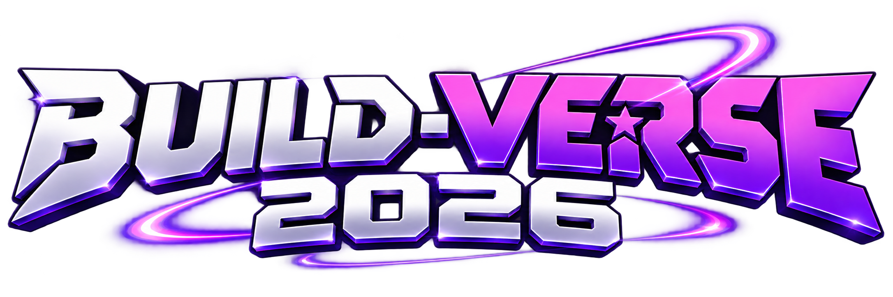

<div align="center">



### Learn. Innovate. Pitch.

The official microsite for **BUILD-VERSE 2026**, a two-day hands-on innovation event
by the **AWS Student Builders Group, Tulas University**.


</div>

---

## Table of contents

- [Event at a glance](#event-at-a-glance)
- [What is on the site](#what-is-on-the-site)
- [Tech stack](#tech-stack)
- [Getting started](#getting-started)
- [Editing event content](#editing-event-content)
- [Project structure](#project-structure)
- [How it works](#how-it-works)
- [Testing](#testing)
- [Deployment](#deployment)
- [Contributing](#contributing)
- [Credits](#credits)

---

## Event at a glance

| | |
| --- | --- |
| **Status** | Concluded successfully. The site is in its "concluded" state and shows the winning teams |
| **Event** | BUILD-VERSE 2026, part of Utkrisht 2026 |
| **Organiser** | AWS Student Builders Group, Tulas University |
| **Dates** | Day 1 on 29 October 2026, Day 2 on 30 October 2026, results on 31 October 2026 |
| **Format** | Learn at college, Build at home, Pitch at college |
| **Venue** | New Seminar Hall, Tulas University (Phase 1 and Phase 3) |
| **Who could join** | Students of Tulas University |
| **Team size** | 1 to 4 members (solo was allowed) |
| **Fee** | ₹100 per team |
| **Registration** | Google Form. It closed on 28 October 2026, 11:59 PM IST |

> The values above mirror `config/buildverse.ts`. If the two ever disagree, the config file is right.

### The three phases

| Phase | Where | When | What happened |
| --- | --- | --- | --- |
| **1. Learn** | At college | 29 Oct, 11:30 AM to 9:00 PM | Three expert sessions: one in person at the New Seminar Hall, two online in the evening |
| **2. Innovate** | At home | 29 Oct evening to 30 Oct | Teams submitted their idea (Form 1 at 6:00 PM), built overnight, and filed a progress report (Form 2 at midnight) |
| **3. Pitch** | At college | 30 Oct, 2:00 PM to 5:30 PM | Final demos and pitches to the judges at the New Seminar Hall |

---

## What is on the site

| Section | What it does |
| --- | --- |
| **Hero** | Title and tagline. Before the event it showed a registration countdown. In the concluded state it shows "Event concluded successfully" and a "See the winners" button |
| **Winners** | Appears only after the event: a thank-you panel and one card per winning team, with place, team lead and members (name, course and year only) |
| **About** | What BUILD-VERSE is, with the mascot artwork and three highlights |
| **Event Flow** | The three phases (Learn, Innovate, Pitch), each tagged **At college** or **At home** |
| **Timeline** | Day 1, Day 2 and results day as a "mission route": a three-phase strip, workshop sessions and the two forms. Before the event it shows live **Up next / Live now / Done** status and time-activated form buttons. After the event it is a plain recap |
| **Tracks** | 5 themes covering 17 innovation tracks. Each theme opens in an accessible modal |
| **Speakers** | Guest speakers and mentors with their session titles, topics and LinkedIn links |
| **Rules** | Eligibility, team size, fee, originality and tooling rules |
| **Prizes & Rewards** | The prize pool |
| **FAQs** | Collapsible answers, including how the hybrid format works |
| **Contact** | Organiser phone numbers and the WhatsApp community link |
| **Closing CTA** | A final thank-you banner over the campus scene, with Utkrisht branding |

Highlights:

- **Static home page.** Built once and served from a CDN. Anything that depends on the visitor's clock (countdown, schedule status, form buttons) is computed in the browser. The concluded state is a config flag, so it never flickers.
- **Mobile first.** Checked at phone widths with no sideways scrolling. The track modal becomes a bottom sheet on small screens, and the mobile tab strip scrolls to keep the active section visible.
- **Accessible.** Native `<dialog>` modal with Esc to close and focus return, visible focus states, reduced-motion friendly animations, and axe checks with no violations on the new sections.
- **Smooth motion.** GSAP scroll animations with Lenis smooth scrolling, turned off on touch devices.
- **One config file.** Dates, phases, tracks, rules, FAQs, prizes, forms, winners and links all live in `config/buildverse.ts`.
- **Privacy by design.** Winner cards show names, courses and years only. A test fails if a long digit string, such as a phone or roll number, ever ends up in the winners data.

---

## Tech stack

| Area | Choice |
| --- | --- |
| Framework | [Next.js 16](https://nextjs.org/) (App Router, Turbopack) |
| UI | React 19, TypeScript 5.7 |
| Styling | Tailwind CSS 3.4 |
| Animation | GSAP + `@gsap/react`, [Lenis](https://lenis.darkroom.engineering/) smooth scroll |
| Icons | `lucide-react` |
| Fonts | Poppins (body), JetBrains Mono (technical labels), Instrument Serif Italic (headings, bundled locally) |
| Images | `next/image` with WebP assets |
| Tests | Node's built-in test runner |

There is no backend, database or environment variable. Registration and the two submission rounds use Google Forms.

---

## Getting started

**Requirements:** Node.js 20 or newer (developed on Node 22) and npm.

```bash
# 1. Clone
git clone https://github.com/piyush-lingwal/BUILDVERSE.git
cd BUILDVERSE

# 2. Install
npm install

# 3. Start the dev server
npm run dev
```

Open <http://localhost:3000>.

### Scripts

| Command | What it does |
| --- | --- |
| `npm run dev` | Start the development server |
| `npm run build` | Create a production build |
| `npm start` | Serve the production build |
| `npm test` | Run the unit tests |

> `next build` downloads Google Fonts (Poppins and JetBrains Mono) at build time, so the first build needs internet access.

---

## Editing event content

Almost everything a visitor reads is edited in **one file**: [`config/buildverse.ts`](config/buildverse.ts). Change a value, redeploy, done.

| To change | Edit this |
| --- | --- |
| **Concluded or live mode** (hides registration, forms and the countdown, adds the Winners section) | `eventConcluded`, `concludedLine` |
| **Winning teams** | `winners`: team name, members (name, course, year, `lead`), plus optional `place`, `medal`, `project`, `track` |
| Registration deadline | `registrationDeadline` |
| Registration form link | `registrationFormUrl` (also update the `/register` redirect in `next.config.ts`) |
| Fee, team size, eligibility | `feeInr`, `teamSize`, `eligibility` |
| The three phases (place, time, summary) | `phases` |
| Schedule (days, times, badges, workshop sessions) | `days[].steps[]` |
| Form 1 and Form 2 links and opening times | `forms`, and the `form` field on the matching step |
| "Results announced" line | `resultsLine` |
| Innovation tracks and themes | `trackTheme`, `trackCategories` |
| Rules and FAQs | `rules`, `faqs` |
| Prize pool | `prize` |
| Speaker cards and poster images | `SPEAKERS_DATA` in `components/Speakers.tsx`, images in `public/buildverse/speakers/` |
| Contacts and WhatsApp link | `contacts`, `whatsappUrl` |

### Showing the winners

```ts
winners: [
  {
    place: "Winner",          // optional; "Winning Team" is shown without it
    medal: "gold",            // optional: "gold" | "silver" | "bronze" (use for the top three)
    team: "Team name",
    members: [
      { name: "First Member", course: "B.Tech CSE", year: "3rd Year", lead: true },
      { name: "Second Member", course: "B.Tech CSE", year: "3rd Year" },
    ],
  },
],
```

Teams appear in the order written. Publish only names, courses and years.

### Schedule rules worth knowing

- Write dates with the IST offset, for example `"2026-10-29T18:00:00+05:30"`. Without the offset, a visitor in another time zone would see the wrong status.
- A step shows **Live now** and **Done** only when it has both `start` and `end`. A step with only `start` shows **Started** after that time.
- A step with no `time` simply shows its badge, for example "Exact timing to be announced".
- Give a step a `phase` (1, 2 or 3) to link it to the phase strip at the top of the timeline, and a `place` to show its **At college** or **At home** chip.
- Form buttons open at `opensAt`. If you set `closesAt` they lock again at that time. Without it they stay open.

Items marked `TODO(organisers)` in the config are placeholders waiting for confirmed information.

---

## Project structure

```
BUILDVERSE/
├── app/
│   ├── layout.tsx                # Root layout, fonts, metadata
│   ├── page.tsx                  # Landing page (/) that composes all sections
│   ├── globals.css               # Tailwind layers, dialog and bottom-sheet styles
│   └── favicon.ico
├── components/
│   ├── Header.tsx                # Sticky nav, mobile scrolling tab strip, top-right button
│   ├── Sections.tsx              # Hero, About, Flow, Rules, Prizes, FAQs, Contact, closing CTA
│   ├── Winners.tsx               # Concluded panel and winning team cards
│   ├── Schedule.tsx              # Timeline (exported as Timeline): live status or recap
│   ├── Speakers.tsx              # Guest speakers and their session details
│   ├── Tracks.tsx                # 5 theme cards and the track modal
│   ├── Countdown.tsx             # Registration countdown (before the event)
│   ├── RegisterButton.tsx        # Register call-to-action that follows the open or closed state
│   ├── SubmissionFormButton.tsx  # Form 1 and Form 2 button that unlocks at its opening time
│   ├── SubmissionFormsBanner.tsx # Not used on the page at the moment
│   ├── useRegistrationOpen.ts    # Browser-side registration open or closed state
│   ├── useCurrentTime.ts         # Shared browser clock for time-based UI
│   ├── GsapMotion.tsx            # Scroll animations
│   ├── SmoothScroll.tsx          # Lenis setup
│   ├── Decor.tsx                 # Sparkles and art dividers
│   ├── Mascot.tsx                # AWS mascot illustrations
│   └── Logos.tsx                 # SBG, BUILD-VERSE and Utkrisht logos
├── config/
│   └── buildverse.ts             # Single source of truth for event content
├── lib/
│   └── state.ts                  # Pure registration, countdown and form-state logic
├── public/buildverse/            # Logos, mascots, speaker posters, trophy art, campus scene, local font
├── tests/
│   └── state.test.ts             # Unit tests for lib/state.ts and config sanity
├── next.config.ts                # Image qualities and the /register redirect
├── tailwind.config.ts
└── package.json
```

---

## How it works

**Static page with live UI.** The server renders `/` once, so it can be cached by a CDN. Anything that depends on the current time uses `useSyncExternalStore` with a server snapshot. The server and the first hydration pass render a neutral state, then the browser swaps in the real one. This avoids hydration mismatches and keeps the page static.

**Concluded mode.** `eventConcluded` is a plain config flag, not a clock check, so every visitor sees the same page whatever their device time. When it is `true`, the hero, navbar, timeline and closing banner switch to their concluded versions and the Winners section is added.

**Pure logic, separate from UI.** `lib/state.ts` holds the countdown, registration and form-state functions. They take `now` as an argument, so tests do not need a fake clock. A broken date in the config counts as **closed**, never open.

**Schedule status.** `Schedule.tsx` reads `start` and `end` from the config and works out which step is live, next or done. The "Up next" banner refreshes on a shared 10 second browser clock.

**Form buttons.** Form 1 and Form 2 unlock in the browser at their `opensAt` time. This is a convenience, not a lock: the form links are part of the public site code, so anyone could open them early. To keep a form truly closed, switch off "Accepting responses" in Google Forms until it should open.

**Registration.** While registration was open, every "Register" button opened the Google Form in a new tab, and `/register` redirected to the same form for posters and QR codes.

---

## Testing

```bash
npm test
```

The tests cover:

- `registrationState` before the deadline, after it, and with an invalid date
- `countdownParts` splitting and never going negative
- config sanity: the deadline falls before Day 1 and the URLs are valid
- schedule sanity: steps are in time order, every `end` is after its `start`, and each of the three phases has a step
- form state: Form 1 and Form 2 links, opening times and clickability around each opening time
- winners: every team has a name and members, each member has a name, course and year, at most one team lead per team, and no long digit strings (phone or roll numbers) in the data

For a quick check before sharing a change, also run `npx tsc --noEmit` and `npm run build`.

---

## Deployment

The site is a standard Next.js app with **no environment variables**. Any host that runs Next.js works: connect the repository, use the default build command (`npm run build`), and add the domain.

1. Connect the repository to your hosting provider.
2. Build command: `npm run build`. Start command (if the host asks): `npm start`.
3. Add your domain in the project settings.
4. Deploy. Most hosts redeploy automatically when `main` changes; check your provider's settings.

---

## Contributing

1. Create a branch from `main`: `git checkout -b feat/your-change`
2. Make a small, focused change. Event content goes in `config/buildverse.ts`.
3. Run `npm test`, `npx tsc --noEmit` and check the page on a phone-sized screen.
4. Commit using a short prefix such as `feat:`, `fix:`, `perf:` or `docs:`.
5. Open a pull request against `main`.

Before editing anything, read [`AGENTS.md`](AGENTS.md): this project uses a recent Next.js version whose APIs can differ from older tutorials.

---

## Credits

- **Organised by** the AWS Student Builders Group, Tulas University
- **Part of** Utkrisht 2026
- **Guest speakers** Mohit Raj (AWS), Sudha Subramaniam (IBM) and the HackOn with Amazon 6.0 winners from NIT Jamshedpur
- Built by the AWS Student Builders Group Tech Lead PIYUSH RAWAT ❤️

For queries about the event, use the contact details and WhatsApp community link on the live site.
